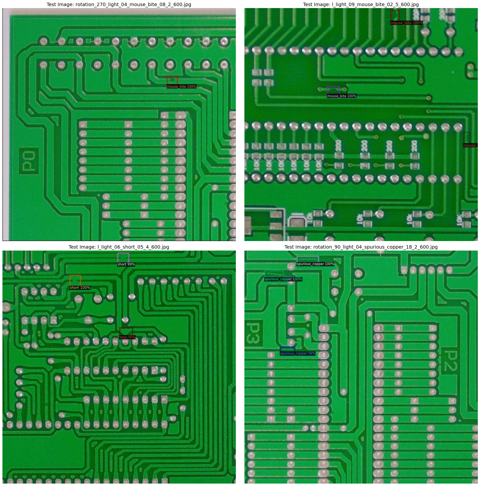
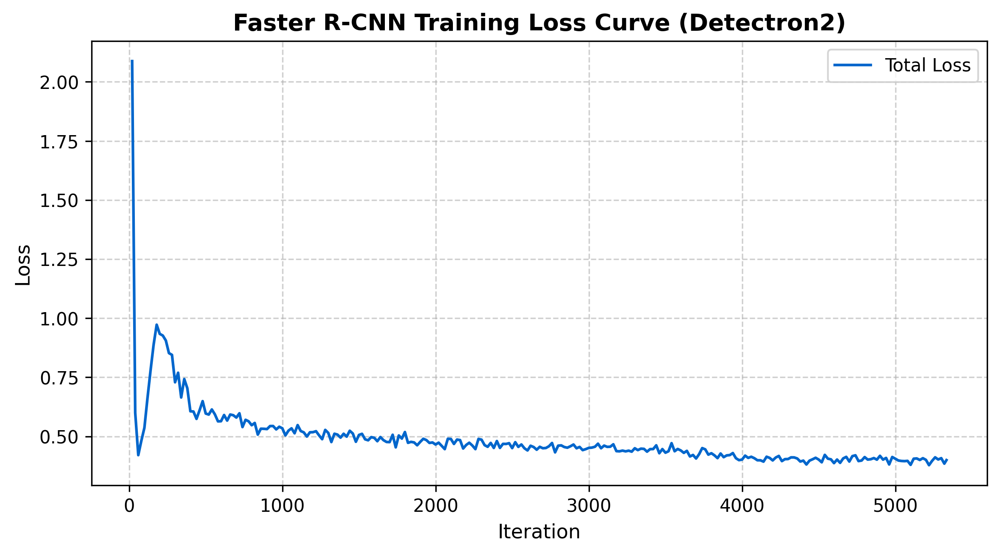

# 🔍 Automated PCB Defect Detection with Detectron2 (Faster R-CNN)

[](https://pytorch.org/)
[](https://github.com/facebookresearch/detectron2)
[](https://opensource.org/licenses/MIT)

An end-to-end computer vision pipeline for automated defect localization and classification on Printed Circuit Boards (PCBs) built on top of Facebook AI Research's **Detectron2** framework using **Faster R-CNN (ResNet-50-FPN)**.

---

## 📌 Visual Detections


---

## 🏷️ Defect Categories
The model detects 6 prominent manufacturing defects:
1. `mouse_bite`
2. `spur`
3. `missing_hole`
4. `short`
5. `open_circuit`
6. `spurious_copper`

---

## ⚙️ Architecture & Hyperparameters
- **Base Architecture:** Faster R-CNN with Feature Pyramid Networks (FPN)
- **Backbone:** ResNet-50 (Pretrained on COCO)
- **Batch Size:** 16 (Optimized for GPU memory)
- **Base Learning Rate:** 0.002 (Warmup iterations: 400)
- **Precision:** Mixed Precision Training (FP16 / AMP)
- **Iterations:** 5,334 steps (~10 Epochs)

---
## 📈 Training Progress
The model was trained for 5,334 iterations using Detectron2 with FP16 precision. Below is the total loss convergence curve:


## 🚀 Quick Setup

### 1. Installation
Clone the repository:
```bash
git clone https://github.com/AmirhosseinBagherinia-dl/pcb-defect-detection-detectron2.git
cd pcb-defect-detection-detectron2
```

Install requirements:
```bash
pip install -r requirements.txt
python -m pip install 'git+https://github.com/facebookresearch/detectron2.git'
```

### 2. Download Pretrained Model
Download `model_final.pth` from [Google Drive](https://drive.google.com/file/d/1l-okN5YCBuJjfTG6SEhg9HbxZaVPpvnP/view?usp=sharing) and place it in the project root.

### 3. Inference
Run prediction on any target PCB image:
```bash
python inference.py --image path/to/pcb_test.jpg --weights model_final.pth --conf 0.5
```

---

## 📊 Dataset & Conversion
This project uses the [Kaggle PCB Defect Dataset](https://www.kaggle.com/datasets/norbertelter/pcb-defect-dataset). The labels are dynamically converted from YOLO format into standard COCO JSON instances.

---

## 📓 Interactive Notebook
You can run and inspect the end-to-end training process directly on Google Colab via `PCB_Defects.ipynb`.